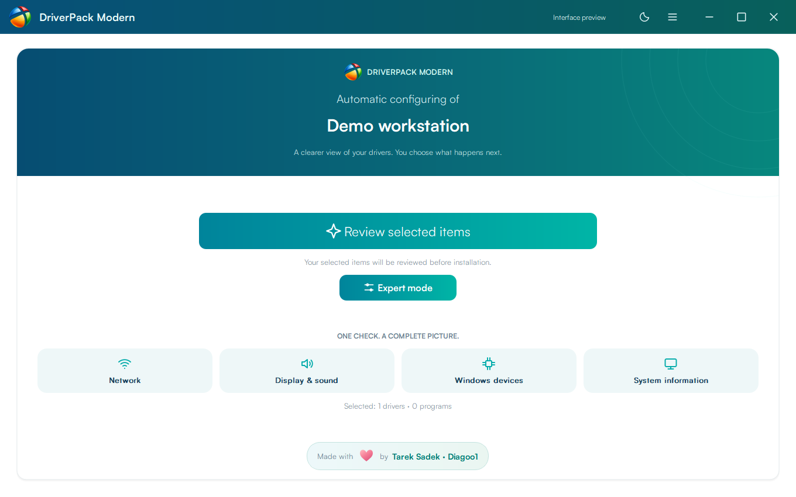
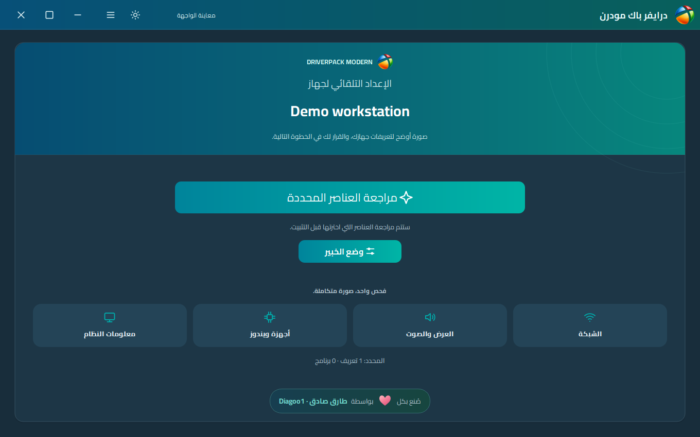
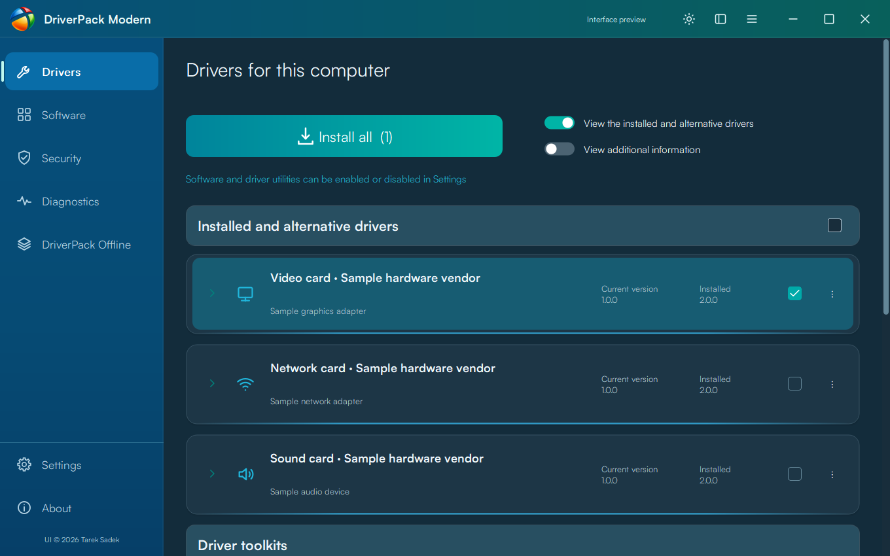
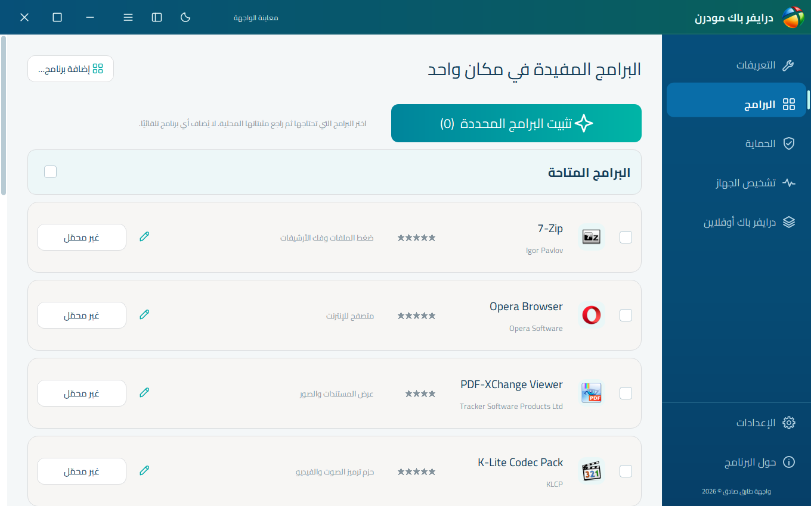
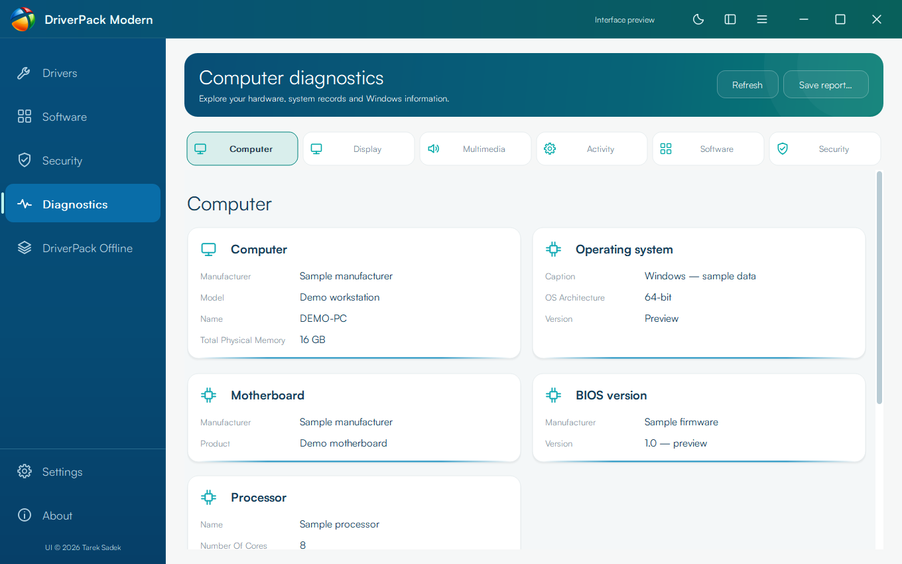
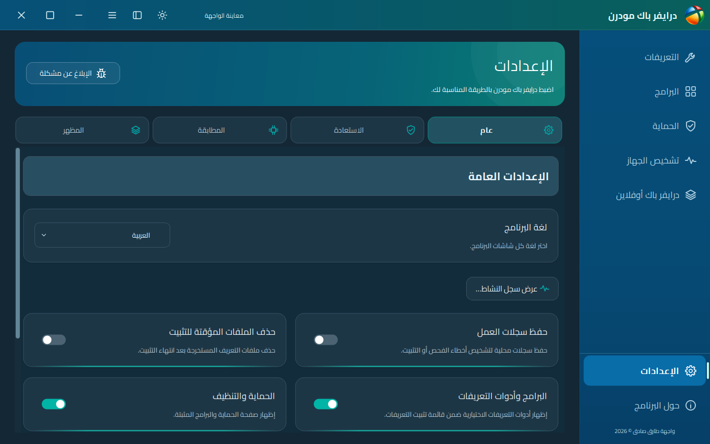

<div align="center">
  
  <h1>DriverPack Modern</h1>
  <p><strong>Your offline library. A clearer Windows experience.</strong></p>
  <p>A native desktop interface for DriverPack libraries — without the original advertising interface.<br>Designed and developed by <strong>Tarek Sadek · Diagoo1</strong></p>
  <p>
    <a href="https://github.com/Diagoo1/DriverPack-Modern/releases/tag/v0.22.2"></a>
    
    
  </p>
  <p><a href="README_AR.md">العربية</a> · <a href="docs/GALLERY.md">Screenshot gallery</a> · <a href="docs/BUILDING.md">Build from source</a> · <a href="https://github.com/Diagoo1/DriverPack-Modern/issues/new?template=bug_report.yml">Report a bug</a></p>
</div>

---

## A familiar workflow, rebuilt for the desktop

Browse driver candidates, review local packages and optional applications, inspect hardware and manage downloads through a rounded, theme-aware interface. Preferences stay in the Windows registry. The portable release is **one EXE with no companion runtime DLLs**; driver archives, the SQLite index and software installers remain external.

**Public Beta:** this is an independent native implementation, not the original DriverPack engine wrapped in a new window. Matching exceptions, legacy installer hooks and online index refreshing are still incomplete. It is not yet a drop-in replacement with guaranteed identical results. See [validation and limits](docs/VALIDATION.md).

## Screenshots

English and Arabic · Light and dark · **Illustrative sample data**. Installation images are interface previews, not evidence of a real installation.

<table>
<tr><td></td><td></td></tr>
<tr><td></td><td></td></tr>
<tr><td></td><td></td></tr>
</table>

[Browse all 52 screenshots →](docs/GALLERY.md)

## What is included

| Area | Available behavior |
| --- | --- |
| Drivers | Compatible local SQLite catalog, hardware-ID candidates, installed/alternative versions, upgrade/downgrade/reinstall review and explicit selection |
| Software | One editable catalog, optional applications, original program artwork when available, category folders and per-program editing |
| Security | Windows protection tools and supported locally reported status; no invented malware verdict |
| Diagnostics | Hardware/system cards, component tables, selectable/copyable values and local reports |
| Offline downloads | Torrent catalog/import, package selection, progress/speed, pause/resume and optional sharing |
| Appearance | Light, dark and system mode, rounded controls, language selection and Arabic RTL; translation coverage varies |
| Logs & support | Searchable local activity viewer, readable HTML export and a GitHub issue form opened only on request |
| Cleanup | An optional CMD launcher with preview/confirmation to convert an existing library to Modern |

No software is selected automatically. Original JavaScript, advertising hooks and unattended bundle arguments are not executed. Software setups are interactive. Torrent hash verification checks consistency with metadata, not publisher identity.

## Get started

1. Download **DriverPackModern.exe** from the [Beta release](https://github.com/Diagoo1/DriverPack-Modern/releases/tag/v0.22.2).
2. Place it beside a compatible DriverPack library, keeping this structure:

```text
DriverPackModern.exe
Clean DriverPack.cmd     (optional; review its cleanup preview first)
drivers/                (driver archives)
index/db.sqlite         (compatible DriverPack catalog)
programs/               (optional installers and catalog.json)
```

3. Open the application, scan and review the candidate/version details. Elevated rights are required for actual system changes. Review restore-point and reboot options before confirming.

A library can also be selected explicitly:

```powershell
.\DriverPackModern.exe --library "D:\DriverPack"
```

The release does **not** bundle DriverPack's library or third-party applications. Settings are stored under `HKCU\Software\TarekSadek\DriverPackModern`.

## Know the current limits

- The matching adapter does not yet implement every original rule, dependency ordering, special installer hook or duplicate-device exception. Unsupported candidates remain ineligible with an explanation.
- Downloading newer driver archives alone does not update `db.sqlite`. Refreshing an index bundled inside an original application archive is not implemented.
- Original cloud classification, accounts, saved-machine matching and SQLite rebuilding are unavailable.
- Windows XP–11 and x86/x64 are targets, **not a completed compatibility certification**. Real installation, restore/reboot and a complete device/VM matrix still need validation.
- New interface descriptions may fall back to English in languages with incomplete dictionaries.

## Documentation

[Software catalog & folders](docs/SOFTWARE.md) · [Cleanup & activity logs](docs/CLEANUP-AND-LOGS.md) · [Build instructions](docs/BUILDING.md) · [Validation](docs/VALIDATION.md) · [Credits & licenses](THIRD_PARTY_NOTICES.md)

## Credits and contributions

Interface design, development and the supplied application emblem: **Tarek Sadek · Diagoo1**. DriverPack Solution and its original authors retain their rights. Program logos, drivers and third-party software belong to their respective owners. This is an independent project, not an official DriverPack product.

Shared visual components come from [Snappy Driver Installer Modern](https://github.com/Diagoo1/Snappy-Driver-Installer-Modern). Project source is GPL-3.0; dependencies keep their own licenses. See [notices](THIRD_PARTY_NOTICES.md).

Reproducible bug reports, compatibility results, translations and pull requests are welcome. Please remove private device details before submitting logs/screenshots.

<div align="center">
  <a href="https://github.com/Diagoo1">GitHub</a> · <a href="https://ko-fi.com/diagoo1">Buy me a coffee</a> · <a href="https://paypal.me/Diagoo1">Support development</a>
</div>
