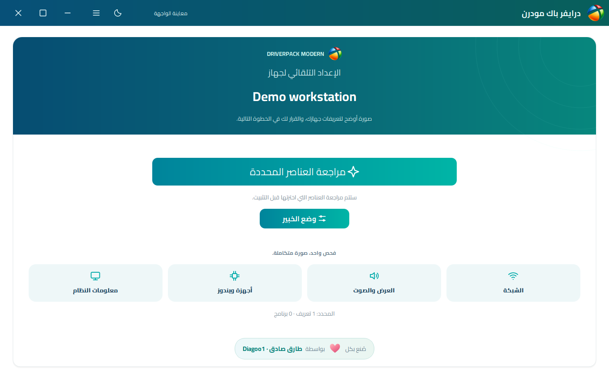
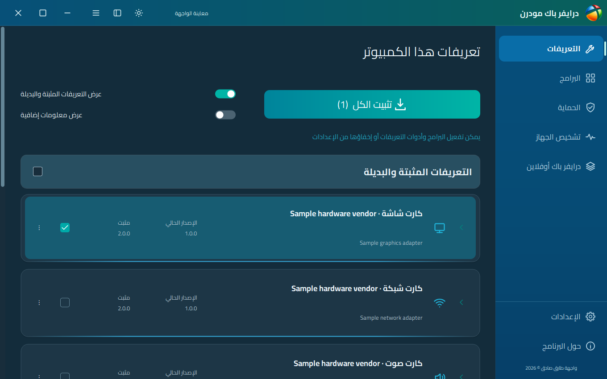
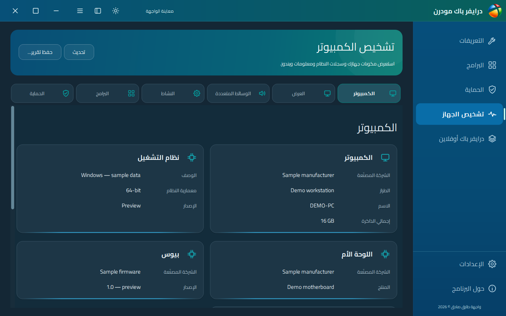
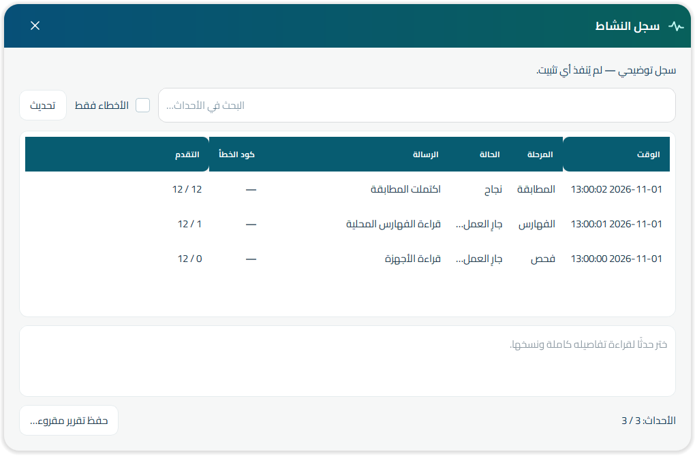

  
  <h1>درايفر باك مودرن</h1>
  
<strong>مكتبتك الأوفلاين، بواجهة أوضح وتجربة ويندوز حديثة.</strong>

  
تصميم وتطوير <strong>طارق صادق · Diagoo1</strong>

  
<a href="https://github.com/Diagoo1/DriverPack-Modern/releases/tag/v0.22.1">تنزيل النسخة التجريبية 0.22.1</a> · <a href="README.md">English</a> · <a href="docs/GALLERY.md">معرض الصور</a> · <a href="https://github.com/Diagoo1/DriverPack-Modern/issues/new?template=bug_report.yml">الإبلاغ عن مشكلة</a>

---

## الفكرة

برنامج مكتبي مستقل بلغة C++ وQt لقراءة مكتبات DriverPack المتوافقة، بواجهة حديثة ذات حواف دائرية، بعيدًا عن واجهة الإعلانات الأصلية. يتيح مراجعة التعريفات وإصداراتها، البرامج الاختيارية، معلومات الجهاز، التحميلات والإعدادات.

ملف التشغيل **EXE واحد دون DLL إضافية**، وتظل حزم التعريفات والفهرس والبرامج بجانبه. تُحفظ التفضيلات في سجل ويندوز. لا يشغّل البرنامج سكربتات DriverPack الأصلية أو معاملات تثبيت الحزم الإعلانية، ولا يحدد البرامج تلقائيًا.

**هذه نسخة بيتا عامة:** قارئ ومطابق التعريفات تنفيذ مستقل، ولم يكتمل نقل جميع قواعد المحرك الأصلي. لذلك لا ندّعي تطابق كل النتائج أو جاهزية كاملة لكل الأجهزة والأنظمة.

## صور من الواجهة

العربية والإنجليزية، الوضع الفاتح والداكن. **الصور ببيانات توضيحية**، وشاشة التثبيت معاينة للشكل دون تنفيذ تثبيت فعلي.

<table>
<tr><td></td><td></td></tr>
<tr><td></td><td></td></tr>
</table>

[عرض الصور الـ52 كاملة ←](docs/GALLERY.md)

## المزايا

| القسم | الوظيفة |
| --- | --- |
| التعريفات | قراءة فهرس SQLite المتوافق، الإصدارات المثبتة والبديلة، ومراجعة الترقية أو الإصدار الأقدم أو إعادة التثبيت |
| البرامج | كتالوج موحد قابل للإضافة والتعديل، مجلدات حسب التصنيف وأيقونات البرامج المتاحة |
| الحماية | أدوات ويندوز وقراءات الحماية المدعومة محليًا دون اختلاق تقييم أمان |
| تشخيص الجهاز | كروت وجداول للمكونات والنظام، نسخ القيم وحفظ التقارير |
| التحميلات | استيراد كتالوج تورنت، اختيار الحزم، متابعة التقدم والسرعة، إيقاف مؤقت واستئناف |
| المظهر | فاتح وداكن وتلقائي، العربية من اليمين لليسار واختيار لغات؛ الترجمة غير مكتملة لكل النصوص |
| الدعم | سجل نشاط محلي قابل للبحث والتصدير، وفتح نموذج بلاغ GitHub بطلب المستخدم |

## التشغيل

نزّل ملف `DriverPackModern.exe` وضعه بجانب مجلدات `drivers` و`index` و`programs` في مكتبة DriverPack متوافقة. يلزم وجود `index/db.sqlite` صالح. الحزم والفهارس وبرامج الطرف الثالث غير مضمنة في التنزيل.

ابدأ بالفحص وراجع تفاصيل الإصدار والحزمة قبل التحديد. يحتاج التثبيت الفعلي صلاحيات المسؤول. راجع خيارات نقطة الاستعادة وإعادة التشغيل قبل التأكيد.

ملف `Clean DriverPack.cmd` اختياري: يفتح وضع تنظيف داخل نفس EXE مع معاينة وتأكيد. يعتمد سياسة الاحتفاظ بالملفات اللازمة وحذف الباقي داخل المكتبة المختارة، وقد يزيل ملفات شخصية غير مرتبطة إن وضعتها هناك. واجهة DriverPack الأصلية لن تعمل بعد تحويل المكتبة. **التنظيف لا يعمل تلقائيًا.**

ملف `logs/native-events.jsonl` سجل تشخيص محلي؛ افتح **الأدوات ← سجل النشاط** أو زر عرضه في الإعدادات لقراءته بتنسيق واضح والبحث وتصدير تقرير HTML. لا يُرفع شيء تلقائيًا.

## ما زال يحتاج تجارب وتطويرًا

قواعد المطابقة الخاصة والاعتماديات وخطافات التثبيت القديمة غير مكتملة. تنزيل أرشيفات أحدث لا يحدّث فهرس SQLite تلقائيًا. خدمات السحابة والحسابات وإعادة بناء الفهرس غير متاحة. لم يكتمل اختبار ويندوز XP إلى 11 بكل المعماريات، ولا التثبيت الفعلي ونقطة الاستعادة وإعادة التشغيل على مصفوفة أجهزة. الصور ليست إثبات نجاح تثبيت.

## الحقوق والمساهمة

الواجهة والتطوير والأيقونة المرفقة من تصميم **طارق صادق · Diagoo1**. حقوق DriverPack Solution محفوظة لمطوريه الأصليين، وحقوق التعريفات والبرامج والشعارات لأصحابها. المشروع مستقل وغير رسمي، والسورس مفتوح بترخيص GPL-3.0 مع احتفاظ المكونات الخارجية بتراخيصها.

التصميم المشترك مستمد من مشروعنا [Snappy Driver Installer Modern](https://github.com/Diagoo1/Snappy-Driver-Installer-Modern). راجع [الحقوق والتراخيص](THIRD_PARTY_NOTICES.md) و[تعليمات البناء](docs/BUILDING.md) و[حدود الاختبارات](docs/VALIDATION.md).

يسعدنا استقبال بلاغات قابلة للتكرار، نتائج تجارب التوافق، الترجمات والمساهمات. راجع الصور والسجلات واحذف البيانات الشخصية قبل نشرها.

[مشاريعي](https://github.com/Diagoo1) · [دعم التطوير](https://ko-fi.com/diagoo1) · [PayPal](https://paypal.me/Diagoo1)
